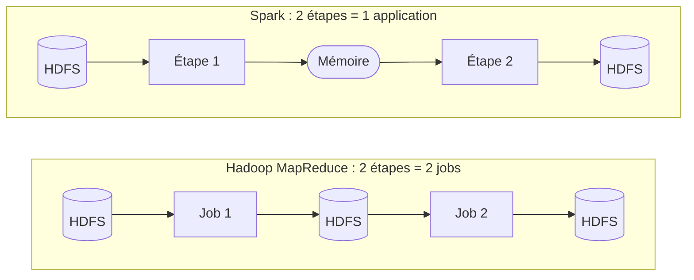
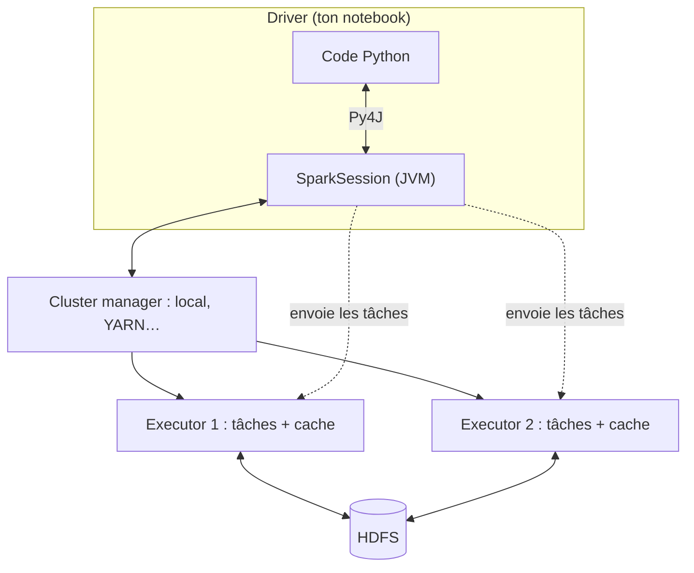
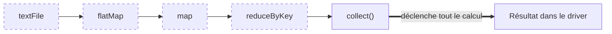
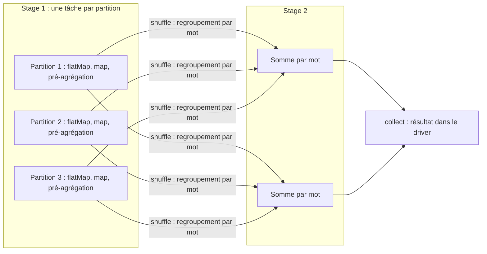

# PySpark en bref

Cours rapide pour préparer la deuxième partie du TP (comptage de mots avec PySpark). Il suppose connus HDFS, YARN et MapReduce, vus dans la première partie.

> Les schémas sont en Mermaid : ils s'affichent sur GitHub et dans VSCode avec l'aperçu *Markdown Preview Enhanced* (`Cmd+K V`).

## 1. Pourquoi Spark après MapReduce ?

Hadoop MapReduce a deux limites, visibles dans le TP :

- **Tout passe par le disque.** Chaque job lit son entrée sur HDFS et y écrit sa sortie. Un traitement en plusieurs étapes enchaîne plusieurs jobs, donc autant d'allers-retours disque.
- **Un seul schéma de calcul.** Tout doit s'exprimer en *map* puis *reduce*. Une jointure ou un algorithme itératif demande beaucoup de code et beaucoup de jobs.

**Apache Spark** garde l'idée de MapReduce (découper les données, traiter les morceaux en parallèle, regrouper par clé), mais :

- il garde les données intermédiaires **en mémoire** entre les étapes ;
- il offre des dizaines d'opérations (`map`, `filter`, `join`, `groupBy`…) au lieu de deux ;
- il planifie le traitement **en entier** avant de l'exécuter, ce qui lui permet de l'optimiser.



Spark **ne remplace pas** tout Hadoop : il remplace le moteur MapReduce. Il continue le plus souvent à lire ses données dans HDFS et peut demander ses ressources à YARN.

## 2. Qu'est-ce que PySpark ?

Spark est écrit en Scala et tourne sur la JVM. **PySpark est son API Python** : on écrit du Python, et Spark exécute le traitement sur la JVM.

Une application Spark a trois types d'acteurs :

| Acteur | Rôle | Équivalent côté Hadoop |
|---|---|---|
| **Driver** | Ton programme. Il construit le plan de calcul et le découpe en tâches. | Le client + l'ApplicationMaster |
| **Cluster manager** | Attribue les ressources (CPU, mémoire). | YARN |
| **Executors** | Processus qui exécutent les tâches et gardent les données en mémoire. | Les conteneurs *map* et *reduce* |



Le point d'entrée dans le code est la **`SparkSession`** :

```python
from pyspark.sql import SparkSession

spark = SparkSession.builder.appName("wordcount").master("local[*]").getOrCreate()
```

Le paramètre `master` choisit où tourne le calcul :

| `master` | Signification |
|---|---|
| `local[*]` | Tout dans un seul processus, un thread par cœur. Aucun cluster nécessaire. |
| `yarn` | Les executors sont des conteneurs YARN, comme pour un job MapReduce. |

## 3. Les données : RDD et DataFrame

Spark propose deux façons de représenter un jeu de données distribué.

| | **RDD** | **DataFrame** |
|---|---|---|
| Contenu | Collection d'objets Python quelconques | Table avec des colonnes nommées et typées |
| Style | Fonctionnel : `map`, `flatMap`, `reduceByKey` | Proche de SQL : `select`, `groupBy`, `count` |
| Exécution en PySpark | Les fonctions Python tournent dans des processus Python, à côté de la JVM | Tout tourne dans la JVM, après optimisation |
| Vitesse en PySpark | Plus lente | Nettement plus rapide en général |
| Usage | Historique, pédagogique | Recommandé aujourd'hui |

Dans les deux cas, les données sont découpées en **partitions**. Une partition est un morceau traité par une tâche. Pour un fichier HDFS, il y a par défaut une partition par bloc de 128 Mo, exactement comme les *splits* de MapReduce.

Un RDD est **immuable** : on ne le modifie jamais, on en crée un nouveau à partir de l'ancien.

## 4. Transformations, actions et évaluation paresseuse

C'est l'idée la plus importante, et la plus déroutante au début.

- Une **transformation** décrit un nouveau jeu de données à partir d'un autre (`map`, `filter`, `flatMap`, `reduceByKey`, `groupBy`…). Elle **ne calcule rien**.
- Une **action** demande un résultat (`collect`, `count`, `take`, `show`, `saveAsTextFile`…). C'est elle qui **déclenche** le calcul.

Tant qu'aucune action n'est appelée, Spark se contente d'enregistrer la liste des opérations, sous forme d'un graphe appelé **DAG** (graphe orienté sans cycle). C'est l'**évaluation paresseuse** (*lazy evaluation*).



**Conséquence pour les mesures du TP** : chronométrer une transformation seule donne environ 0 seconde. Il faut chronométrer jusqu'à l'action incluse.

## 5. Le comptage de mots en PySpark

### Version RDD : le même schéma que MapReduce

```python
compte = (
    spark.sparkContext.textFile("hdfs://localhost:8020/user/…/words.txt")
    .flatMap(lambda ligne: ligne.split())      # ligne → mots
    .map(lambda mot: (mot, 1))                 # mot → (mot, 1)
    .reduceByKey(lambda a, b: a + b)           # somme par mot
)
resultat = compte.collect()                    # action : le calcul démarre ici
```

Correspondance avec la première partie du TP :

| Étape | Pseudo-MapReduce Python | Hadoop MapReduce | PySpark (RDD) |
|---|---|---|---|
| Émettre `(mot, 1)` | `mapper` | *Mapper* | `flatMap` + `map` |
| Pré-agréger localement | — | *Combiner* | inclus dans `reduceByKey` |
| Regrouper par mot | `shuffle` | *Shuffle* | inclus dans `reduceByKey` |
| Sommer | `reducer` | *Reducer* | la fonction passée à `reduceByKey` |

`reduceByKey` fait donc à lui seul le *combiner*, le *shuffle* et le *reduce*.

### Version DataFrame

```python
from pyspark.sql import functions as F

compte = (
    spark.read.text("hdfs://localhost:8020/user/…/words.txt")   # une colonne "value"
    .select(F.explode(F.split("value", r"\s+")).alias("mot"))
    .groupBy("mot")
    .count()
)
compte.show()
```

Même résultat, mais aucune fonction Python n'est exécutée ligne par ligne : Spark traduit ces opérations en un plan optimisé qui tourne entièrement dans la JVM.

## 6. Ce que Spark fait réellement : jobs, stages, tâches

Quand une action est appelée, Spark découpe le DAG :

- **Job** : tout le calcul déclenché par une action.
- **Stage** : une suite de transformations qui s'enchaînent sans déplacer les données entre partitions.
- **Tâche** : l'exécution d'un stage sur une partition. C'est l'unité envoyée à un executor.

Ce qui sépare deux stages, c'est un **shuffle**. On distingue donc deux familles de transformations :

| Famille | Définition | Exemples | Coût |
|---|---|---|---|
| **Étroite** (*narrow*) | Chaque partition de sortie dépend d'une seule partition d'entrée | `map`, `flatMap`, `filter` | Faible, pas de transfert |
| **Large** (*wide*) | Les données sont redistribuées entre partitions selon la clé | `reduceByKey`, `groupBy`, `join` | Élevé : c'est un *shuffle* |

Pour le comptage de mots, cela donne deux stages, soit la même structure que *map* puis *reduce* :



Pendant l'exécution, tout cela se voit dans l'**interface web de Spark** : `http://localhost:4040` (onglets *Jobs*, *Stages*, *Executors*). C'est l'équivalent de la console YARN utilisée dans la première partie.

## 7. Spark face à Hadoop MapReduce

| | Hadoop MapReduce | Spark |
|---|---|---|
| Données intermédiaires | Sur disque | En mémoire (disque si nécessaire) |
| Opérations | *map* et *reduce* | Des dizaines, plus SQL |
| Traitements en plusieurs étapes | Un job par étape | Une seule application, un seul plan |
| Algorithmes itératifs | Lents (relecture du disque à chaque itération) | Rapides (données gardées en cache) |
| Coût fixe de démarrage | Élevé (un job YARN par traitement) | Plus faible, payé une fois par session |
| Tolérance aux pannes | Relance de la tâche, données sur disque | Recalcul de la partition perdue à partir du DAG |
| Besoin en mémoire | Faible | Plus important |
| Langages | Java surtout | Python, Scala, Java, SQL, R |

## 8. Ce qu'il faut attendre dans le TP

Quelques hypothèses à **vérifier par la mesure**, pas à tenir pour acquises :

- **Petit fichier** : Spark aura lui aussi un coût fixe (démarrage de la JVM et de la session), de l'ordre de quelques secondes. Python simple devrait rester le plus rapide.
- **Gros fichier** : Spark devrait faire mieux que Hadoop MapReduce, surtout avec l'API DataFrame.
- **RDD ou DataFrame** : la version RDD paie le passage de chaque ligne entre la JVM et Python. L'écart avec la version DataFrame est lui-même un résultat intéressant à montrer.
- **Mémoire** : comme Hadoop, Spark lit le fichier par partitions. Il ne devrait donc pas échouer par manque de mémoire comme les scripts Python, à condition de ne pas ramener dans le driver un résultat énorme avec `collect()`. Ici le résultat ne fait que 15 lignes.
- **Une seule machine** : comme dans la première partie, tout tourne sur un seul nœud. Le parallélisme est limité au nombre de cœurs du Mac.

Points de méthode pour que la comparaison reste juste :

- chronométrer **jusqu'à l'action** (voir § 4) ;
- dire clairement si le temps de démarrage de la session Spark est compté ou non, puisque celui de Hadoop l'était ;
- lire les **mêmes fichiers**, depuis HDFS, que le job Hadoop.

## 9. Installation

```bash
.venv/bin/pip install pyspark
```

Ce paquet contient Spark lui-même : rien d'autre à télécharger pour le mode `local[*]`. Spark a besoin de Java, et le JDK 17 déjà utilisé pour Hadoop convient.

À vérifier au moment de l'installation : la compatibilité de la version de PySpark installée avec Python 3.14, qui est très récent.

## À retenir

1. Spark reprend le principe de MapReduce, mais travaille **en mémoire** et planifie tout le traitement avant de l'exécuter.
2. PySpark est l'**API Python** de Spark ; le calcul tourne sur la JVM.
3. Les **transformations** sont paresseuses, seules les **actions** déclenchent le calcul.
4. Un **shuffle** coûte cher et délimite les *stages*.
5. En PySpark, l'API **DataFrame** est à préférer à l'API RDD pour les performances.
